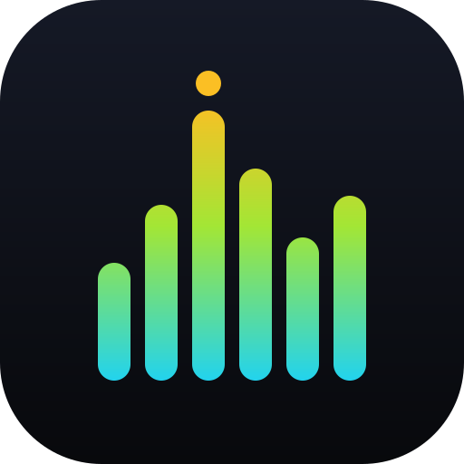
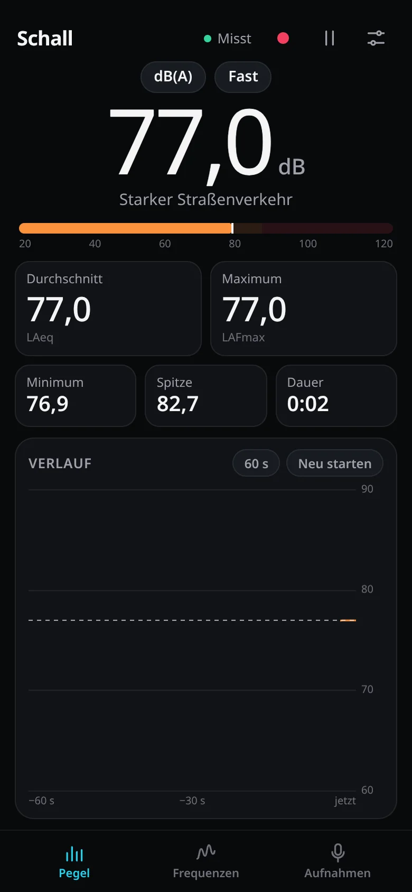
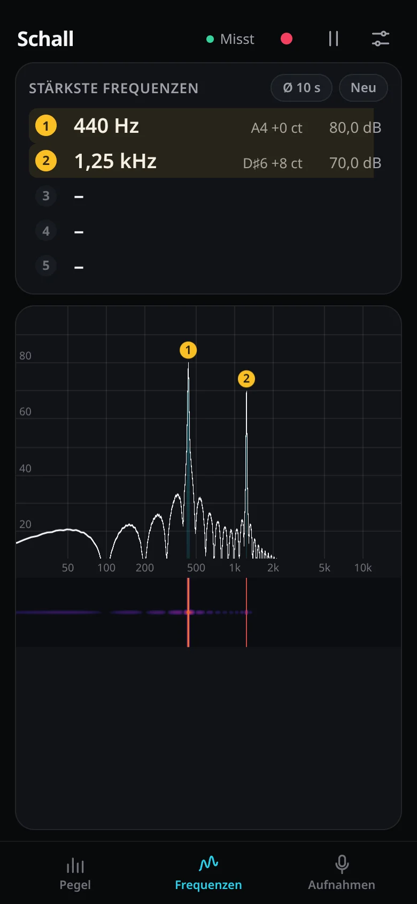
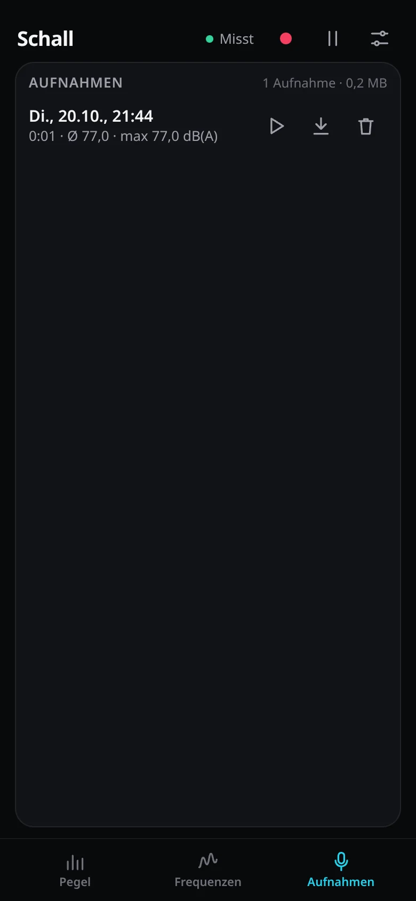

<div align="center">



# Schall

**Sound level meter and frequency analyser for your phone, in the browser.**

How loud is it on average, how loud at its worst, and which frequencies
dominate: the hum of a motor, the tone of a fan, concert pitch A, the drone in
an aircraft cabin. Record it, play it back, keep it as a WAV file.

[**Open the app →**](https://michaelkrisper.github.io/schall/)

[](https://github.com/michaelkrisper/schall/actions/workflows/deploy.yml)
[](LICENSE)



&nbsp;

&nbsp;


</div>

## Contents

- [Features](#features)
- [Getting started](#getting-started)
- [Measuring well](#measuring-well)
- [How it works](#how-it-works)
- [Accuracy and validation](#accuracy-and-validation)
- [Browser support](#browser-support)
- [Privacy](#privacy)
- [Development](#development)
- [Testing](#testing)
- [Project structure](#project-structure)
- [Contributing](#contributing)
- [License](#license)
- [References](#references)

## Features

**Level**

- Current level in large digits, with an everyday description ("Normales
  Gespräch", "Starker Straßenverkehr") and a colour-coded bar.
- **Average (Leq)** and **maximum** since you started, plus minimum, peak and
  measuring time.
- Frequency weighting A, C or Z and time weighting Fast (125 ms) or Slow
  (1 s), as defined by IEC 61672-1.
- History chart over the last minute or ten minutes, with the average marked.

**Frequencies**

- The **five strongest tones**, to about 0.1 Hz, with the nearest note and
  its deviation in cents ("A4 +0 ct").
- **History-aware ranking:** tones are followed over time and ranked by the
  level they reach at least half of the time, so a steady hum is found even
  when something louder comes and goes. A bar shows how steadily each tone is
  there. The window is 1 s, 10 s or everything since "Neu".
- **Harmonics** are marked ("3× ①" = three times the frequency of no. 1),
  which tells a motor's or fan's overtones from separate sources.
- Live spectrum and averaged spectrum on a logarithmic 20 Hz - 20 kHz axis,
  with numbered markers, and a spectrogram of the last ~11 seconds. Touch the
  plot to read frequency, level and note anywhere.

**Recordings**

- One tap records exactly what is being measured, as 16-bit mono WAV.
- Stored in the browser while recording, so nothing is lost if the app is
  closed; listed with date, duration, average and maximum.
- Play back in the app (the measurement pauses meanwhile, so the speaker does
  not end up in your numbers), save via the share sheet on phones ("Save to
  Files", AirDrop) or download on desktops, delete with a second tap.

**App**

- Installable PWA, works offline, keeps the screen on while measuring, no
  zooming or text selection: it behaves like a native app.
- Calibration against a reference reading in one step.
- No account, no backend, no tracking.

## Getting started

1. Open **https://michaelkrisper.github.io/schall/** on your phone.
2. Install it: on iPhone *Share → Add to Home Screen*, on Android *Install
   app* in the browser menu.
3. Tap **Messung starten** and allow the microphone.
4. Calibrate once (see below). Without calibration, levels can be off by
   several dB; frequencies are exact either way.

### Calibration

Phone microphones are not calibrated, and their sensitivity differs between
models. Put the phone next to a sound level meter, or next to a phone running
a vetted app such as [NIOSH SLM](https://www.cdc.gov/niosh/noise/about/app.html)
(free, iOS, developed by the US National Institute for Occupational Safety and
Health). Play a steady sound, open *Settings*, enter the reference reading
under *Referenz zeigt* and tap *Abgleichen*. The correction can also be
adjusted in 0.5 dB steps.

## Measuring well

- **Average noise** (a room, a street, a neighbour): tap *Neu starten*, keep
  the phone still and away from your body, and let it run. The average
  (LAeq) settles after a minute or two; the maximum shows the loudest moment.
- **Main frequency of a machine, fan or engine:** open *Frequenzen*, choose
  *Ø 10 s* or *Ø gesamt* and wait a few seconds. Steady tones move to the top,
  their harmonics are marked. In an aircraft cabin, a car or next to a fan,
  the first entries are the engine, blade or motor tones.
- **Tuning or pitch:** the first entry shows the note and cents; with
  *Ø 1 s* the list follows quickly.
- **Loud sound:** above roughly 110-120 dB phone microphones clip, and the
  readings stop being meaningful.

## How it works

All signal processing runs on the browser's audio thread, in a small
WebAssembly module (13 KB) compiled from Rust with SIMD instructions. The page
itself only draws and keeps statistics.

```
microphone ─► AudioWorklet ─► dsp.wasm (Rust, no_std, SIMD128)
                                ├─ A/C weighting: biquads in f64x2 lanes (A and C side by side), Z scalar
                                ├─ Fast/Slow, Leq, min/max, peak: f32x4 lanes (A, C, Z)
                                ├─ real FFT, 16384 points, Blackman-Harris window, every ~21 ms:
                                │    radix-4 stages with four butterflies per instruction,
                                │    SIMD window + deinterleave, split into the real spectrum
                                ├─ averages over 1 s, 10 s and since the reset, dB via a SIMD log
                                └─ max-pooling of 8192 bins into one value per display column
           ─► page: levels (20/s), display rows (47/s), full spectra (4/s)
                ├─ statistics and history chart (Canvas 2D)
                ├─ tone tracker: peaks of each spectrum followed over time, ranked by L50
                └─ WebGL2: spectrum and spectrogram from float textures (ring of rows, colour map in the shader)
```

Details worth knowing:

- **Weighting filters.** The low poles use the bilinear transform; the
  12.2 kHz double pole, which a bilinear transform squeezes towards Nyquist,
  is a magnitude-matched second-order section (Vicanek). Result: within
  0.03 dB of the IEC 61672 curves up to 12.5 kHz at 44.1 and 48 kHz.
- **Spectrum.** 16384 points give 2.9 Hz bins at 48 kHz; the Blackman-Harris
  window keeps sidelobes at -92 dB, so a tone 50 dB weaker right next to a
  strong one is still found. Peak frequency and level are refined by a
  parabola through the top three bins (on a log scale).
- **Tone tracker.** Four times a second the strongest peaks of the latest
  spectrum are matched to tracks within ±0.4 % (a tone may drift), and each
  track records when it was present and how loud. Ranking by the level
  reached at least half of the time (L50, absence counting as silence) puts
  steady tones first; tones present less often follow.
- **Speed.** The whole DSP chain takes about 1 % of one desktop CPU core;
  the radix-4 FFT with windowing, averaging and column pooling needs about
  0.16 ms per spectrum.

## Accuracy and validation

Every number below is checked by an automated test against an analytic
reference (see [Testing](#testing)):

| What | Verified |
| --- | --- |
| Level of a sine (A, C, Z; Leq, Fast; max, min) | ±0.02 dB; ±0.05 dB |
| A/C weighting vs. the IEC 61672-1 table, 31.5 Hz - 8 kHz | ±0.1 dB |
| A/C/Z filters vs. the analog weighting curves, 20 Hz - 12.5 kHz | ±0.05 dB |
| Weighted level of sines from 31.5 Hz to 12.5 kHz at 44.1/48 kHz | ±0.1 dB |
| FFT vs. a direct DFT with the same window | ±0.01 dB per bin |
| SIMD dB conversion | ±0.001 dB |
| Frequency of a tone in noise (50 Hz - 7.8 kHz) | ±0.1 Hz |
| Level of a tone from the spectrum | ±0.3 dB |
| Weak tone 50 dB below a strong one, 300 Hz away | found |
| Steady quiet tone vs. loud intermittent bursts | steady tone ranked first |

What it cannot be: a certified instrument. Phone microphones roll off below
~100 Hz and above ~10 kHz and differ between models, the operating system may
process the signal, and very loud sound clips. For finding frequencies and
for comparisons this hardly matters; for absolute levels, calibrate.

## Browser support

| Browser | Minimum | Notes |
| --- | --- | --- |
| Safari (iOS, iPadOS, macOS) | 16.4 | WebAssembly SIMD; works as a home screen app |
| Chrome, Edge (Android, desktop) | 91 | |
| Firefox | 89 | |

Needed: AudioWorklet, WebAssembly SIMD, IndexedDB; WebGL2 for spectrum and
spectrogram (everything else works without it). The microphone requires
HTTPS or `localhost`.

## Privacy

The microphone signal is processed on the device only. There is no backend,
no analytics and no third-party code; recordings and settings stay in the
browser's storage until you share or delete them. See [SECURITY.md](SECURITY.md).

## Development

Requirements: Node.js 24. For changes to the DSP core: Rust with the
WebAssembly target (`rustup target add wasm32-unknown-unknown`).

```sh
git clone https://github.com/michaelkrisper/schall.git
cd schall
npm ci
npm run serve        # http://localhost:8080
```

There is no bundler: `src/` is the app as deployed. `src/dsp.wasm` is
checked in, so Rust is only needed to change the core; CI rebuilds it from
`wasm/` on every push.

| Script | What it does |
| --- | --- |
| `npm run serve` | Local server with gzip, like GitHub Pages |
| `npm run wasm` | Build `wasm/` and copy the module to `src/dsp.wasm` |
| `npm run lint` / `lint:fix` | Biome: format and lint JavaScript, CSS, JSON |
| `npm run lint:rust` | rustfmt and clippy (warnings are errors) |
| `npm test` | All tests |
| `npm run test:unit` / `test:browser` | Node-only tests / the app in headless Chrome |
| `npm run check` | What CI runs: lint and all tests |
| `npm run screenshots` | Refresh the images in `docs/` |
| `npm run icons` | Render the PNG icons from `src/icons/icon.svg` |

Every push to `main` runs rustfmt, clippy, Biome and all tests, builds the
core and deploys to GitHub Pages; the smoke test afterwards checks the live
files ([deploy.yml](.github/workflows/deploy.yml)).

## Testing

67 tests with Node's built-in test runner, no test dependencies:

| File | Tests | Covers |
| --- | --- | --- |
| [`test/core.test.js`](test/core.test.js) | 24 | The WebAssembly core in Node: sine levels in A/C/Z at 44.1, 48 and 96 kHz, any block size, time weighting, DC offset, full-scale square wave, silence, the FFT against a direct DFT, SIMD dB conversion, tone frequency and level, a weak tone next to a strong one, harmonics, all averaging modes, reset, display columns, invalid sizes, speed |
| [`test/dsp.test.js`](test/dsp.test.js) | 17 | Filter design against the IEC 61672 table and curves, notes, peak finding, formatting, statistics and history ring, WAV header and file names |
| [`test/tracker.test.js`](test/tracker.test.js) | 5 | Tone tracker: steady before transient, louder-but-mostly-there first, drift, windows, and a hum among loud bursts on the real core |
| [`test/structure.test.js`](test/structure.test.js) | 8 | Offline cache and module preloads complete, element ids exist, icon sizes, Rust and JavaScript agree on buffer layouts, versions match |
| [`test/app.test.js`](test/app.test.js) | 13 | The app in headless Chrome with a fake microphone playing two known tones: levels on screen, the frequency list, the WebGL spectrogram, averaging, recording and the WAV file, playback, delete, calibration, pause, history range, no zoom, settings after a reload, no console errors |

The browser test is skipped when no Chrome is installed (set `CHROME` to its
path otherwise).

## Project structure

```
src/                     the app as deployed
  index.html, styles.css, manifest.webmanifest, sw.js
  dsp.wasm               the DSP core, built from wasm/
  js/main.js             start/pause, tabs, settings, recording, render loop
  js/audio.js            microphone → AudioWorklet
  js/worklet.js          audio thread: feeds dsp.wasm, posts results
  js/dsp.js              filter design, peak finding, notes, formatting (pure)
  js/stats.js            level statistics and history (pure)
  js/tracker.js          tone tracker (pure)
  js/level-view.js       level tab
  js/spectrum-view.js    frequency tab, WebGL2 and overlay
  js/recorder.js         recordings in IndexedDB, WAV files
  js/recordings-view.js  recordings tab
wasm/src/lib.rs          the DSP core in Rust (no_std, no dependencies)
scripts/                 dev server, wasm and icon builds
test/                    tests, see above
docs/                    screenshots
```

## Contributing

Bug reports, measurements that look wrong and pull requests are welcome; see
[CONTRIBUTING.md](CONTRIBUTING.md). Changes are listed in
[CHANGELOG.md](CHANGELOG.md).

## License

[MIT](LICENSE) © 2026 Michael Krisper

## References

- IEC 61672-1:2013, *Electroacoustics - Sound level meters - Part 1:
  Specifications* (frequency and time weightings, Annex E).
- M. Vicanek, *Matched Second Order Digital Filters*, 2016.
- F. J. Harris, *On the use of windows for harmonic analysis with the
  discrete Fourier transform*, Proc. IEEE 66 (1), 1978.
- NIOSH Sound Level Meter app, US National Institute for Occupational Safety
  and Health.
